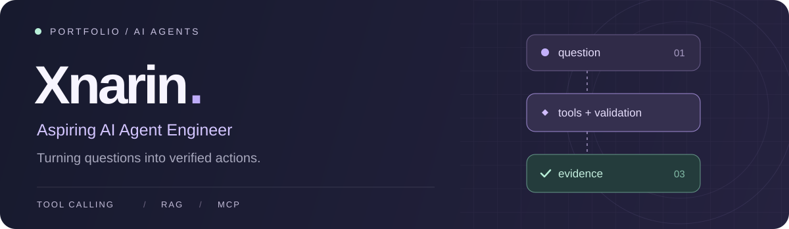
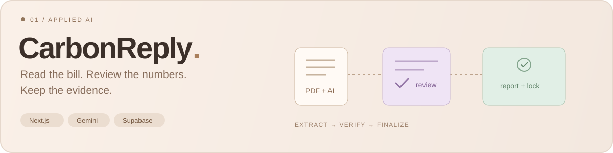
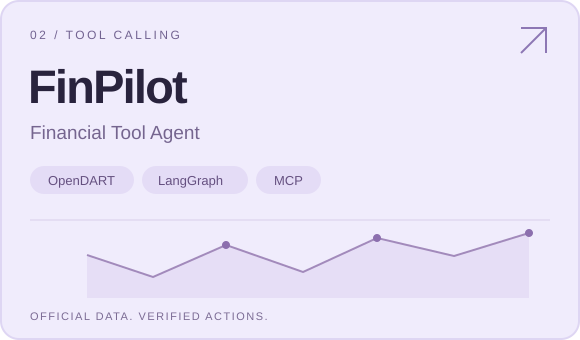
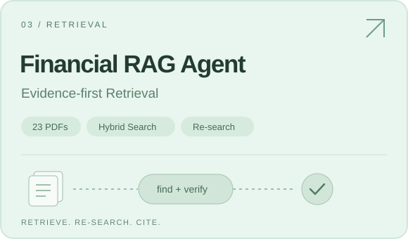

  

  금융 데이터와 문서를 근거로 답하는 에이전트를 만듭니다. 
  <strong>도구 실행의 검증</strong>과 <strong>검색·답변 품질의 개선</strong>에 관심이 있습니다.

 

### Selected work

**AI가 읽은 고지서, 사람이 확인하고 코드로 확정합니다.**  
PDF 추출 → 원본 대조·수정 → Scope 2 계산 → 확정 스냅샷과 PDF 리포트

Next.js · TypeScript · Gemini · Supabase · Vitest · Playwright

[**Repository ↗**](https://github.com/Xnarin/CarbonReply) &nbsp; [서비스 열기](https://carbon-reply.vercel.app) &nbsp; [설계·구현](https://github.com/Xnarin/CarbonReply#핵심-설계)

 

<table>
<tr>
<td width="50%" valign="top">
  
   
  
<strong>조회부터 계산까지, 근거가 남는 금융 에이전트</strong>

  
공식 공시를 조회하고 코드로 계산합니다. 사용자가 말한 조건을 검증하고, 모호하면 되묻습니다.

  
개인 프로젝트 · Python / LangGraph / MCP

  
<a href="https://github.com/Xnarin/finpilot"><strong>Repository ↗</strong></a> &nbsp; <a href="https://github.com/Xnarin/finpilot/blob/main/docs/evaluation/eval_results.md">평가 기록</a>

</td>
<td width="50%" valign="top">
  
   
  
<strong>문서 구조를 살리고, 부족한 근거는 다시 검색</strong>

  
표·용어·조항을 반영해 문서를 나눕니다. 검색과 답변의 품질·비용·지연을 비교합니다.

  
3인 팀 실습 · Python / Chroma / BM25

  
<a href="https://github.com/Xnarin/financial-rag-agent"><strong>Repository ↗</strong></a> &nbsp; <a href="https://github.com/Xnarin/financial-rag-agent/blob/main/docs/실험기록.md">실험 기록</a>

</td>
</tr>
</table>

<strong>프로젝트를 조금 더 자세히</strong>

#### CarbonReply · AI Document Workflow

- **추출과 검토:** PDF에서 청구연월·kWh를 읽고 서버 검증 후 사용자가 원본과 대조합니다.
- **계산과 확정:** 확인된 월별 값으로 배출량을 계산하고, 확정 당시의 값·계수를 스냅샷으로 남깁니다.
- **변경 잠금:** 확정 자료의 수정을 DB 트리거로 막고, 검증·계산·확정 조건 테스트를 갖췄습니다.

[주요 구현](https://github.com/Xnarin/CarbonReply#코드-살펴보기) · [테스트 안내](https://github.com/Xnarin/CarbonReply/blob/main/AUTOMATED_TESTING.md)

#### FinPilot · Tool Calling & MCP

- **검증:** 회사·연도에 대한 사용자 발화 근거를 대조하고, 확정되지 않은 조건의 조회를 막습니다.
- **계산:** 숫자·표·비교 문장은 코드로 생성하고, 공시 접수번호와 출처를 남깁니다.
- **실행 제어:** 호출 한도·캐시·되묻기를 구현하고, 같은 금융 도구 4개를 MCP 서버로 제공합니다.

[에이전트 코드](https://github.com/Xnarin/finpilot/blob/main/agent_core.py) · [MCP 서버](https://github.com/Xnarin/finpilot/blob/main/mcp_server.py) · [실제 화면](https://github.com/Xnarin/finpilot#어떤-대화가-되나)

#### Financial RAG Agent · Retrieval & Evaluation

- **문서 처리:** 금융 PDF 23개에서 표 제목·용어 정의·약관 조항을 반영한 청킹을 적용합니다.
- **검색:** 벡터·BM25 Hybrid 검색과 이웃 청크를 사용하고, 근거가 부족하면 최대 2회 재검색합니다.
- **비교:** 같은 조건의 120문항 평가에서 기본 RAG **0.854 → Agent 0.904**를 기록했습니다.

프로젝트 자체 비교 실험 결과입니다. 점수는 채점 LLM이 기준 답안과 비교해 부여한 0·0.5·1점의 평균입니다.

[에이전트 코드](https://github.com/Xnarin/financial-rag-agent/blob/main/agent/graph.py) · [실험 설계](https://github.com/Xnarin/financial-rag-agent/blob/main/docs/실험계획.md)

 

### Toolkit

  
  
  
  
  
  

Retrieval &nbsp; Chroma · BM25 · Kiwi &emsp; / &emsp; Evaluation &nbsp; pytest · Golden sets

  

Find the evidence. Validate the action. Measure the result.

